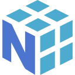
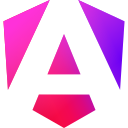

<h1 align="center">Hi, I'm Abderrafea! 👋</h1>
<h3 align="center">AI Engineering · Data Science · Software Development</h3>

  <strong>Double-degree student · ENSAM Rabat 🇲🇦 × UBO Brest 🇫🇷</strong>

  <a href="https://www.linkedin.com/in/abderrafea-elamri/">LinkedIn</a> &nbsp;·&nbsp;
  <a href="https://github.com/Abderrafea?tab=repositories">Explore my projects</a>

---

### 👨‍💻 A bit about me

I'm studying **Data Science & Artificial Intelligence at ENSAM Rabat** and **Software Development for Information Systems at UBO**, through a double-degree program.

I enjoy connecting **data, intelligent systems and useful software**: exploring a dataset, building an AI workflow, designing an API and bringing it together in a web application.

- 🤖 Working with **LLMs, RAG, AI agents and fine-tuning with LoRA / PEFT**.
- 📊 Exploring data through **EDA, feature engineering, visualization and conversational analytics**.
- ⚙️ Building applications with **Python, Java, FastAPI, Spring Boot and TypeScript**.
- 🎯 Next step: **final-year internship · April 2027 · AI, Data Science or Software Development**.

### 🧰 Tech stack

**Programming**

   &nbsp;
   &nbsp;
  

**AI & Data Science**

   &nbsp;
   &nbsp;
  

`LangGraph` · `LlamaIndex` · `Hugging Face Transformers` · `RAG` · `AI Agents` · `LoRA / PEFT` · `Matplotlib` · `Seaborn`

**Backend, Frontend & Databases**

   &nbsp;
   &nbsp;
   &nbsp;
   &nbsp;
  

**Dev Tools & Infrastructure**

   &nbsp;
   &nbsp;
  

`Spring Cloud` · `RabbitMQ` · `REST APIs` · `SQL` · `Pytest` · `CI/CD`

### 🚀 Featured projects

- **📊 [InsightForge](https://github.com/Abderrafea/InsightForge)** — Build and refine PostgreSQL dashboards through conversation, with schema exploration and validated read-only SQL. `FastAPI` `LangGraph` `React` `PostgreSQL`
- **🤖 [Excel Agent AI](https://github.com/Abderrafea/excel-agent-ai)** — Ask questions about Excel data, create charts, compare results and generate business reports. `Python` `Pandas` `FastAPI` `Angular`
- **⚙️ [Recruitment Microservices](https://github.com/Abderrafea/recrutement-microservices)** — Recruitment workflows with an API gateway, service discovery, JWT authentication and asynchronous notifications. `Spring Boot` `Spring Cloud` `React` `RabbitMQ`
- **🛒 [Ecommerce Website](https://github.com/Abderrafea/Ecommerce_Website)** — Product catalog, shopping cart, orders and administration in a full-stack web application. `Node.js` `Express` `Vue.js` `MongoDB`

### 🎓 Background

- **UBO, Brest:** Master 2 DOSI — Software Development for Information Systems, since 2026.
- **ENSAM Rabat:** Engineering in Data Science & Artificial Intelligence, since 2024.
- **Internships:** AI Engineering at **GEODEMAT** (2026) · Full-stack Development at **VPI INFO** (2025).

### ☕ Let's connect

I enjoy discussing practical AI, interesting datasets and software that solves real problems. Feel free to explore my projects or [reach out on LinkedIn](https://www.linkedin.com/in/abderrafea-elamri/).

**French** · **English** · **Arabic**

Technology icons: [Devicon](https://github.com/devicons/devicon), distributed under the [MIT license](assets/DEVICON-LICENSE.txt).
